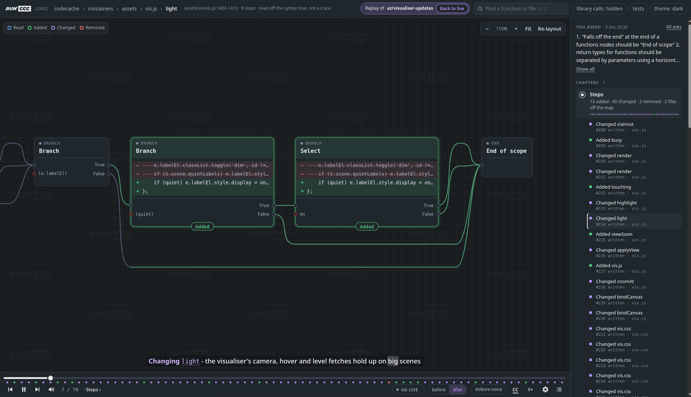
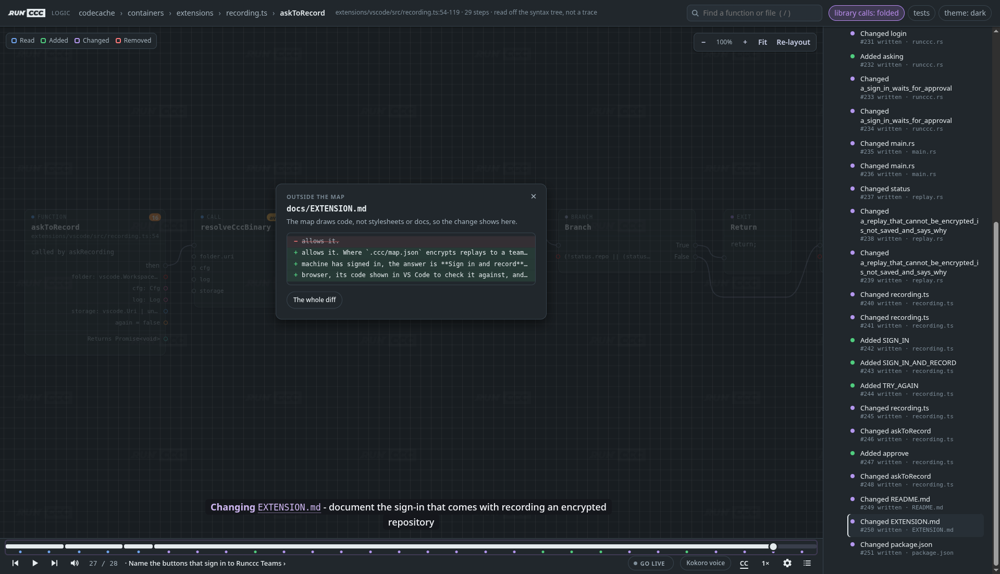

# Code Change Capture (ccc) for VS Code

See what every change touches before you commit it, watch an agent's edits land on a live map of your code, and replay how a branch was built.

The extension runs the `ccc` analyser in the background for each workspace folder. Nothing leaves your machine.

## See the impact of your changes

Save a file and each function you changed shows what it affects, right above its signature:

| Hint | What it tells you |
|---|---|
| `✓ 3 tests` | Tests reach this change. Click to open them, nearest first. |
| `✗ no smoke test` | Nothing tests it, and which kind of test to write. |
| `→ billing` · `← gateway` | It calls into another service, or another service calls it. |
| `↑ calls billing in acme/billing` | It calls into another repository. Click to open the handler there. |
| `▲ 37 callers` · `↻ cycle of 3` | A hot path or a call cycle. These show on every file, changed or not. |

The **ccc** panel in the activity bar lists every test your changes put at risk, with a command that runs exactly those tests. It also ranks every function by complexity, worst first, and a circled number from 1 to 10 next to each function's name shows its complexity in the editor.

## Visualiser

A map of your project you can drill into: from the system and its services, through files and functions, down to the logic inside a single function. While an agent edits through ccc, the visualiser moves to each change as it lands and draws it in place, with added lines in green and removed ones struck through. Open it in the panel, in a tab beside your code, or in a browser.

## Replays

Play back how a change was made: what you asked, what the agent read, and every edit it made, split into chapters, shown in subtitles and read aloud. Replays are saved beside your branch when you push, so reviewers can watch them too.

- **Recording is off until you turn it on** for a repository, with **ccc: Session Recording…**. The extension never records or pushes a replay by itself.
- **Secrets are removed** before anything is saved.
- **Public remotes are protected.** A replay never goes to a remote anyone can read, unless it's encrypted for your team or `.ccc/map.json` allows it.

## Get started

1. Install the extension. It uses the `ccc` on your machine, or downloads the right release if there isn't one.
2. Open a folder that's a git repository and change some code.
3. Save. Hints appear on the functions you changed.

For hints about services and other repositories, describe your services in `.ccc/map.json`. Run `ccc init` to create a starter file.

## Commands

| Command | What it does |
|---|---|
| `ccc: Refresh Hints` | Analyse again now. |
| `ccc: Open Architecture Visualiser` | Open the visualiser in a tab beside your code. |
| `ccc: Copy Test Command for Changes` | Copy the command that runs exactly the tests your changes put at risk. |
| `ccc: Select Git Base Ref...` | Choose the branch your changes are compared against. |
| `ccc: Session Recording…` | Turn replay recording on or off for this repository. |
| `ccc: Toggle Inline Hints` | Show or hide all hints. |
| `ccc: Restart Analyser` / `ccc: Stop Analyser` | Restart or stop the background analyser. |
| `ccc: Show Log` | Open the extension's log, including the analyser's own output. |

## Settings

- `ccc.baseRef`: the ref to compare against. Defaults to the first of `origin/main`, `main`, `origin/master` and `master` that exists.
- `ccc.hints.*`: turn each kind of hint on or off. `ccc.hints.codeLens: false` with `ccc.decorations.style: badge+gutter` shows end-of-line badges instead of lenses.
- `ccc.complexity.enabled` and `ccc.complexity.minScore`: the complexity numbers, and the lowest one worth showing.
- `ccc.search.mode`, `ccc.search.urls` and `ccc.search.endpoints`: what the analyser's `search` tool may reach on the web. For example, only your company's docs and portals.
- `ccc.binaryPath` and `ccc.autoInstall`: use your own `ccc`, or stop the extension downloading one.
- `ccc.server.*`: how the analyser runs. `ccc.server.extraArgs` passes extra `ccc run` options.

How the hints are worked out, every setting in detail, and troubleshooting are in the [Developers And Agents guide](../../docs/Advanced.md#ides).

## License

MIT
